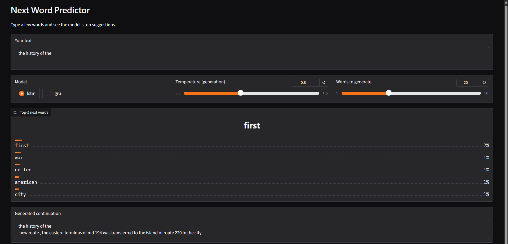
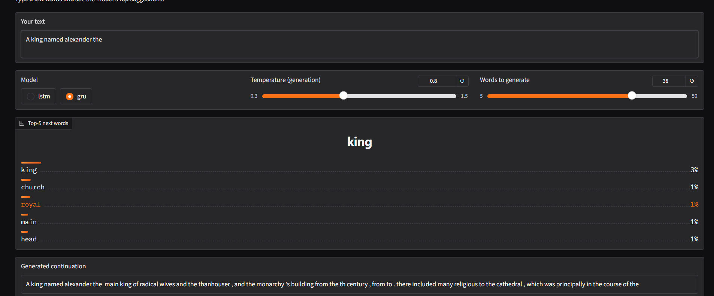

# Next Word Predictor: LSTM vs GRU

Word-level next-word prediction with recurrent networks in PyTorch, trained on WikiText-2,
with held-out evaluation (perplexity, top-k accuracy) and a live Gradio demo.

Inspired by [Bharath-K3/Next-Word-Prediction-with-NLP-and-Deep-Learning](https://github.com/Bharath-K3/Next-Word-Prediction-with-NLP-and-Deep-Learning).

## What's different from the original
- Larger dataset (WikiText-2) instead of one short book
- Validation/test splits with perplexity and top-1/3/5 accuracy
- LSTM vs GRU comparison with identical hyperparameters
- Interactive demo: top-5 suggestions, temperature slider, text generation

## Results
Trained for 12 epochs on WikiText-2 (10k-word vocabulary, sequence length 35, best checkpoint by validation loss).

| Model | Params | Test perplexity | Top-1 | Top-3 | Top-5 |
|---|---|---|---|---|---|
| GRU | 10.4M | 126.2 | 22.5% | 38.3% | 45.3% |
| LSTM | 11.4M | 108.7 | 24.1% | 40.2% | 47.1% |

The LSTM generalized better in this setup. Its validation perplexity flattened around 114, while the GRU was still creeping down at 133.
Caveats: one run per model, and the LSTM has about 9% more parameters.



## Failure cases

- **Low confidence:** for "a king named alexander the", the top suggestion gets only about 3%, and the next four are close behind. The model has no world knowledge, so it cannot complete "alexander the great".
- **Topic drift:** generated text is locally grammatical but wanders off topic, because the model only sees a short window and was trained on about 2M words.
- **Bug found and fixed:** my first tokenizer stripped digits, so "19th century" became "th century". Numbers are now kept.

## Run
```bash
pip install -r requirements.txt
python train.py --model lstm --epochs 12
python train.py --model gru --epochs 12
python compare.py
python app.py
```
Use `--data path/to/file.txt` to train on your own text.

## Limitations and next steps
- Closed 10k-word vocabulary: unseen words become `<unk>`
- No pretraining, so world knowledge and long-range context are weak
- Next steps: subword tokenizer, small transformer, comparison against a pretrained model such as DistilGPT-2
